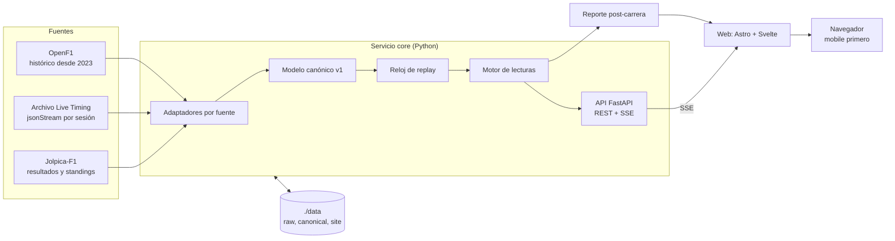
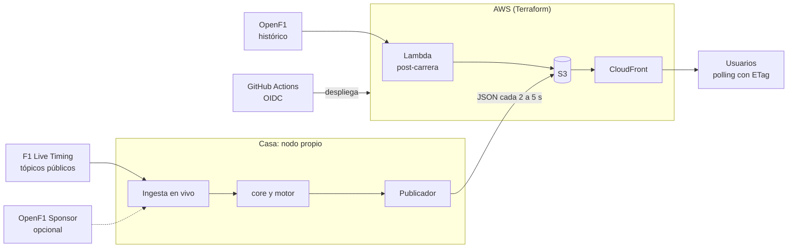

# Arquitectura

ApexPulse convierte datos de timing en lecturas interpretadas. La arquitectura separa la ingesta (que depende de fuentes inestables) del motor de lecturas (que es la lógica de producto) mediante un modelo canónico de eventos.

## Arquitectura local (fases 1 y 2)

En la compu corren dos contenedores, `core` y `web`, sobre un volumen `./data`. No hay bases de datos ni servicios externos: las fuentes se descargan una vez y de ahí en adelante todo funciona sin red.



| Componente | Responsabilidad | Ubicación |
|------------|-----------------|-----------|
| Adaptadores | Descargar, guardar el crudo, validar el esquema y emitir eventos canónicos | services/core/src/apexpulse/sources/ |
| Modelo canónico | Contrato de eventos v1: vuelta, boxes, stint, gap, dirección de carrera, estado de pista, clima | services/core/src/apexpulse/model/ |
| Reloj de replay | Reproducir eventos a velocidad variable y saltar a una vuelta | services/core/src/apexpulse/replay/ |
| Motor de lecturas | Aplicar reglas determinísticas y producir lecturas con evidencia | services/core/src/apexpulse/readings/ |
| API | REST para sesiones, SSE para estado y lecturas | services/core/src/apexpulse/api/ |
| Reporte | Generar el JSON del post-carrera por sesión | services/core/src/apexpulse/report/ |
| Web | Vista "En carrera" con islas Svelte y post-carrera estático | web/ |

Layout de datos:

```text
data/
├── raw/<año>/<sesion>/<fuente>/*.jsonl.zst   # crudo tal como llegó, más manifest.json
├── raw/<año>/_<fuente>/                       # catálogo de sesiones del año por fuente
├── state/                                     # estado del límite de tasa por fuente
├── canonical/<sesion>.parquet                 # eventos canónicos v1
└── site/post/<sesion>.json                    # entrada del post-carrera
```

## Arquitectura objetivo en la nube (fase 3)

Pendiente del ADR de nube (H6). La opción recomendada es AWS con Terraform. La ingesta en vivo corre en un nodo propio con IP residencial, porque F1 bloquea rangos de IP de cloud; la nube solo distribuye archivos.



Flujos:

1. Durante una sesión, el nodo propio ingiere, corre el mismo core que en local y publica un JSON compacto cada 2 a 5 segundos.
2. CloudFront lo sirve con TTL corto; los clientes hacen polling con ETag. Si el archivo deja de actualizarse, la web lo detecta por la marca de tiempo y lo avisa.
3. Al terminar cada sesión, una Lambda programada baja el histórico de OpenF1 y regenera el post-carrera.
4. Fuera de sesión no hay cómputo encendido, solo archivos estáticos.

## Decisiones relacionadas

- [0002 Modelo canónico de eventos](adr/0002-modelo-canonico-de-eventos.md)
- [0003 MVP solo con replay](adr/0003-mvp-solo-con-replay.md)
- [0004 SSE y polling cacheado](adr/0004-sse-y-polling-cacheado.md)
- [0005 Datos en archivos](adr/0005-datos-en-archivos.md)
