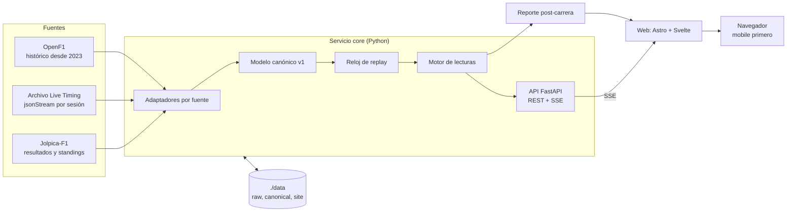
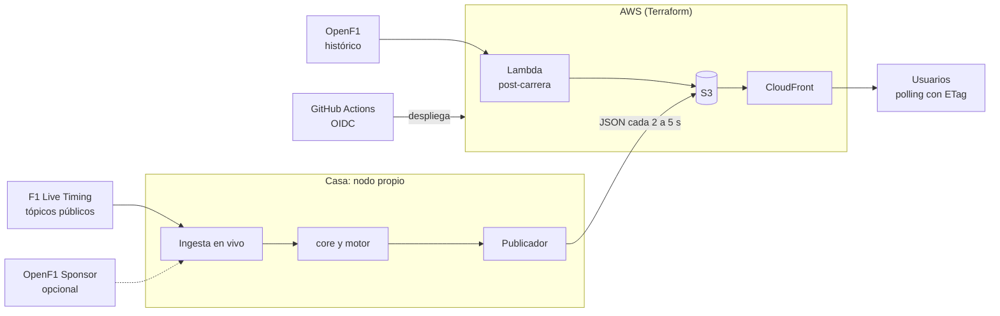

# Arquitectura

ApexPulse convierte datos de timing en lecturas interpretadas. La arquitectura separa la ingesta (que depende de fuentes inestables) del motor de lecturas (que es la lógica de producto) mediante un modelo canónico de eventos.

## Arquitectura local (fases 1 y 2)

En la compu corren dos contenedores, `core` y `web`, sobre un volumen `./data`. No hay bases de datos ni servicios externos: las fuentes se descargan una vez y de ahí en adelante todo funciona sin red.



| Componente | Responsabilidad | Ubicación |
|------------|-----------------|-----------|
| Adaptadores | Descargar, guardar el crudo, validar el esquema y emitir eventos canónicos | services/core/src/apexpulse/sources/ |
| Modelo canónico | Contrato de eventos v1: vuelta, boxes, stint, gap, dirección de carrera, estado de pista, clima | services/core/src/apexpulse/model/ |
| Reloj de replay | Reproducir eventos a velocidad variable y saltar a una vuelta | services/core/src/apexpulse/replay/ |
| Motor de lecturas | Aplicar reglas determinísticas y producir lecturas con evidencia | services/core/src/apexpulse/readings/ |
| API | REST para sesiones, SSE para estado y lecturas | services/core/src/apexpulse/api/ |
| Reporte | Generar el JSON del post-carrera por sesión | services/core/src/apexpulse/report/ |
| Web | Vista "En carrera" con islas Svelte y post-carrera estático | web/ |

## Reloj de replay

Paquete `apexpulse.replay`. Reproduce `data/canonical/<sesion>.parquet` sobre un reloj inyectable, con multiplicador de velocidad, pausa y seek. Lo usa `make replay` y lo va a usar la API con SSE en H3.

| Pieza | Módulo | Qué hace |
|-------|--------|----------|
| `Clock`, `SystemClock`, `FakeClock` | `replay/clock.py` | `monotonic()` y `sleep()`. El falso avanza al dormir y registra cada espera; lo usan todos los tests |
| `Replay` | `replay/player.py` | Ordena la emisión en el tiempo, agrupa en lotes, pausa, cambia la velocidad y hace seek |
| `RaceState` | `replay/state.py` | Estado acumulado: fold puro de los eventos (`apply`) |
| `ConsolePrinter` | `replay/console.py` | Líneas de texto para la consola |

### Tiempo real y posición de sesión

Hay dos tiempos que no se mezclan: el real, que da el reloj, y la posición de sesión, en la escala de `t`. Se vinculan con un ancla `(real0, pos0)`:

```text
pos = pos0 + (reloj.monotonic() - real0) * speed
```

Pausar, reanudar, cambiar la velocidad o hacer seek solo mueven el ancla. A `speed=30`, un hueco de 60 s entre dos lotes es una espera real de 2 s. Con `speed=None` (`NOWAIT=1`) no hay esperas. Cada espera real dura como máximo `max_sleep_s` (0,5 s), para atender pausas o seeks pedidos mientras espera.

`max_gap_s` (por defecto None) recorta los huecos: si faltan más de `max_gap_s` segundos de sesión hasta el próximo lote, la posición salta hasta quedar a esa distancia. Ejemplo: durante la bandera roja de Mónaco 2026 (14:35:06 a 15:12:00 UTC) solo llegan muestras de clima cada 60 s; con `max_gap_s=30` a x1, la suspensión se reproduce en unos 23 minutos en lugar de 37.

El núcleo no bloquea: `due_in()` dice cuántos segundos reales faltan para el próximo lote y `pop_due()` lo emite si ya venció. `run()` es el bucle bloqueante que usa la consola. La API de H3 puede manejar el mismo objeto desde asyncio.

### Orden y lotes

El replay no reordena. Emite las filas en el orden del Parquet, que es el de `sort_key` del normalizador: instante, tipo (`driver`, `race_control`, `track_status`, `lap`, `pit`, `stint`, `position`, `interval`, `weather`), piloto, vuelta y contenido. Al cargar valida ese orden y la versión mayor del esquema; si alguno falla, pide volver a correr `make normalize`. Los eventos con el mismo instante salen juntos en un lote, sin espera entre ellos. Por ejemplo, los 22 eventos `driver` salen en el primer lote, con la largada.

Cada evento sale como un `Step` con la vuelta en curso y el líder en el momento en que ocurrió, antes de aplicarlo.

### Seek con estado acumulado

- La posición inicial es el inicio de la sesión (`SessionMeta.start`). Los eventos anteriores, como el clima y la dirección de carrera de la previa, se pliegan al estado sin emitirse.
- `seek(t)` deja el estado igual a aplicar, en orden, todos los eventos con instante anterior a `t`. El próximo lote es el primero con instante igual o posterior a `t`. Un `t` anterior al inicio se ajusta al inicio. Hacia adelante sigue plegando desde el cursor; hacia atrás arma el estado de cero (32.000 eventos de una carrera se pliegan en milisegundos). Los eventos que se saltean no se emiten, y la pausa y la velocidad no cambian.
- `seek_lap(n)` va al instante en que el primer auto completa la vuelta `n-1` e incluye ese lote, así `state.lap == n`. Si la sesión no tiene datos de esa vuelta, falla.
- El invariante, cubierto por tests, es que el estado después de un seek es el mismo que el de reproducir hasta ese instante.

### Convención de vuelta

La vuelta N es la vuelta en curso del líder. Empieza cuando el primer auto completa la N-1. Se calcula como el máximo de vueltas completadas por cualquier auto más uno, y queda fija en la vuelta de la bandera a cuadros. Es la misma convención en los marcadores de la consola, en `seek_lap` y en `RaceState.lap`, y coincide con el `lap` de los mensajes de dirección de carrera.

Ejemplo de Mónaco 2026: ANT completa la vuelta 59 a las 14:18:59.989 UTC y el SC sale a las 14:20:02, 62 s después. Por eso el SC queda en la vuelta 60, como en el mensaje de la FIA (`SAFETY CAR DEPLOYED`, lap 60).

El líder que se nombra es el piloto en posición 1, no el que más vueltas completó. Pueden diferir por un instante, por ejemplo cuando un auto completa la vuelta antes de que llegue su evento de posición. Una posición nueva desplaza al que la tenía hasta que llegue su propio evento. Si la sesión no trae eventos de posición 1, el marcador muestra `---`. Pasa en el fixture recortado de Mónaco, porque OpenF1 publica la posición solo cuando cambia.

`RaceState` guarda, además, los pilotos (`driver`), el estado de pista, el clima y, por auto, la posición, la última vuelta, el stint vigente, el último intervalo y las paradas. Las paradas se cuentan solo con `stationary_s` no nulo; las pasadas por el pit lane sin detención se cuentan aparte.

Layout de datos:

```text
data/
├── raw/<año>/<sesion>/<fuente>/*.jsonl.zst   # crudo tal como llegó, más manifest.json
├── raw/<año>/_<fuente>/                       # catálogo de sesiones del año por fuente
├── state/                                     # estado del límite de tasa por fuente
├── canonical/<sesion>.parquet                 # eventos canónicos v1
└── site/post/<sesion>.json                    # entrada del post-carrera
```

## Arquitectura objetivo en la nube (fase 3)

Pendiente del ADR de nube (H6). La opción recomendada es AWS con Terraform. La ingesta en vivo corre en un nodo propio con IP residencial, porque F1 bloquea rangos de IP de cloud; la nube solo distribuye archivos.



Flujos:

1. Durante una sesión, el nodo propio ingiere, corre el mismo core que en local y publica un JSON compacto cada 2 a 5 segundos.
2. CloudFront lo sirve con TTL corto; los clientes hacen polling con ETag. Si el archivo deja de actualizarse, la web lo detecta por la marca de tiempo y lo avisa.
3. Al terminar cada sesión, una Lambda programada baja el histórico de OpenF1 y regenera el post-carrera.
4. Fuera de sesión no hay cómputo encendido, solo archivos estáticos.

## Decisiones relacionadas

- [0002 Modelo canónico de eventos](adr/0002-modelo-canonico-de-eventos.md)
- [0003 MVP solo con replay](adr/0003-mvp-solo-con-replay.md)
- [0004 SSE y polling cacheado](adr/0004-sse-y-polling-cacheado.md)
- [0005 Datos en archivos](adr/0005-datos-en-archivos.md)
