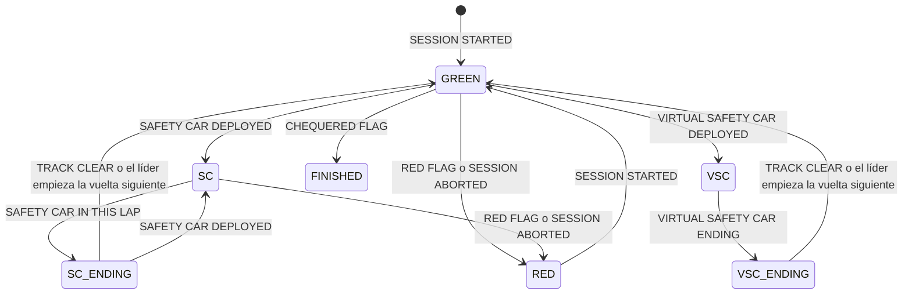

# Modelo de eventos canónico

Contrato entre los adaptadores de fuente y el resto del sistema (ADR 0002). El replay, el motor de lecturas y la API solo conocen estos eventos; el formato de OpenF1 o del archivo estático queda dentro de `sources/`. Versión vigente: **1.0**.

Código: `services/core/src/apexpulse/model/` (`events.py` con los tipos en Pydantic v2, `parquet.py` con la persistencia).

## Generar los eventos

```bash
make fetch SESSION=2026-monaco-r       # crudo en data/raw (una vez)
make normalize SESSION=2026-monaco-r   # eventos en data/canonical/2026-monaco-r.parquet
```

Salida real:

```text
2026-monaco-r (openf1 a canónico v1.0): 32331 eventos
  interval        29916
  lap              1445
  pit                86
  position          291
  race_control      269
  stint             108
  track_status        8
  weather           208
Estado de pista:
  13:03:11  vuelta  1  GREEN      SESSION STARTED
  14:20:02  vuelta 60  SC         SAFETY CAR DEPLOYED
  14:29:41  vuelta 65  SC_ENDING  SAFETY CAR IN THIS LAP
  14:30:34  vuelta 65  GREEN      TRACK CLEAR
  14:31:18  vuelta 66  SC         SAFETY CAR DEPLOYED
  14:35:06  vuelta 68  RED        SESSION ABORTED
  15:12:00  vuelta 68  GREEN      SESSION STARTED
  15:26:43  vuelta 78  FINISHED   CHEQUERED FLAG
AVISO: laps: vueltas sin tiempo ni vuelta siguiente, omitidas: 7 (por ejemplo piloto 16 vuelta 65)
Canónico en .../data/canonical/2026-monaco-r.parquet
```

Las horas son UTC. El archivo pesa unos 580 KB por carrera. Si falta el crudo, el comando falla con `Correr primero: make fetch SESSION=<id>`.

## Principios

- **Un instante por evento.** Todo evento tiene `t`, con zona horaria, normalizado a UTC. Un instante sin zona horaria es un error de validación.
- **Sin información del futuro.** Un evento solo contiene lo que se sabía en `t`. Por eso `stint` no lleva la vuelta en que termina y `lap` se emite al cruzar la línea, no al empezar la vuelta.
- **Hechos de la fuente, no interpretaciones.** El modelo guarda tiempos y estados; decidir si una parada fue "barata" es trabajo de las reglas. La única derivación es `track_status`, porque OpenF1 no lo publica como dato.
- **Validación estricta.** Modelos inmutables, sin campos extra (`extra="forbid"`) y con rangos: piloto entre 1 y 99, tiempos no negativos, humedad entre 0 y 100.
- **Determinismo.** Misma entrada, mismo archivo, byte a byte. El orden es total (ver [Orden](#orden)) y el archivo no guarda la hora de generación.

## Tipos de evento

Campos comunes: `t` (instante UTC) y `kind` (discriminador). `driver` es el número del auto y `lap` el número de vuelta. Un campo con `?` puede ser null.

| kind | Clase | Cuándo ocurre | Campos |
|------|-------|---------------|--------|
| `lap` | `LapCompleted` | El piloto cruza la línea al terminar la vuelta | `driver`, `lap`, `lap_time_s?`, `s1_s?`, `s2_s?`, `s3_s?`, `pit_out` |
| `stint` | `StintStarted` | Empieza la vuelta `lap`, primera del stint | `driver`, `lap`, `stint`, `compound`, `tyre_age` |
| `pit` | `PitLane` | Paso por el pit lane | `driver`, `lap`, `lane_s?`, `stationary_s?` |
| `position` | `PositionChanged` | Cambia la posición en la clasificación | `driver`, `position` |
| `interval` | `IntervalUpdated` | Nueva distancia al líder y al auto de adelante | `driver`, `gap_s?`, `laps_down?`, `interval_s?`, `interval_laps?` |
| `race_control` | `RaceControlMessage` | Mensaje de dirección de carrera | `category`, `message`, `flag?`, `scope?`, `sector?`, `driver?`, `lap?` |
| `track_status` | `TrackStatusChanged` | Cambia el estado de pista | `status`, `lap?`, `cause` |
| `weather` | `WeatherSample` | Muestra de la estación meteorológica | `air_c`, `track_c`, `rain`, `humidity_pct?`, `wind_ms?`, `wind_deg?`, `pressure_hpa?` |

Detalle de los campos que no son obvios:

- `lap.lap_time_s` null: la fuente no tiene el tiempo (por ejemplo, la vuelta en que se muestra la bandera roja). El evento se emite igual al empezar la vuelta siguiente; si tampoco hay vuelta siguiente, se omite con un aviso.
- `stint.compound`: `SOFT`, `MEDIUM`, `HARD`, `INTERMEDIATE`, `WET` o `UNKNOWN`. `tyre_age` son las vueltas que tenía el juego al empezar el stint: 0 es un juego nuevo.
- `pit.stationary_s` null: no hay detención registrada. Bajo SC la dirección de carrera puede mandar a todos por el pit lane (`ALL CARS THROUGH THE PIT LANE`) y esas pasadas también son eventos `pit`. `lane_s` puede ser enorme durante una bandera roja: los autos esperan en el pit lane.
- `interval`: un auto doblado tiene `laps_down` (1, 2...) y `gap_s` null. Si la fuente también informa el intervalo en vueltas, va en `interval_laps`.
- `race_control.lap`: vuelta del líder cuando se emitió el mensaje. El texto queda en inglés, tal como lo publica la FIA.
- `track_status.cause`: el mensaje que produjo el cambio, o la regla de cierre (`el líder empieza la vuelta 66`).

Ejemplos reales de 2026-monaco-r, tal como los devuelve `read_events` (con `model_dump(mode="json")`):

```json
{"t": "2026-06-07T14:20:02Z", "kind": "track_status", "status": "SC", "lap": 60, "cause": "SAFETY CAR DEPLOYED"}
{"t": "2026-06-07T14:24:06.829000Z", "kind": "pit", "driver": 5, "lap": 59, "lane_s": 24.824, "stationary_s": 2.5}
{"t": "2026-06-07T14:22:51.100000Z", "kind": "pit", "driver": 41, "lap": 59, "lane_s": 20.2, "stationary_s": null}
{"t": "2026-06-07T13:50:13.988000Z", "kind": "interval", "driver": 41, "gap_s": null, "laps_down": 1, "interval_s": 0.495, "interval_laps": null}
```

El primero abre el SC de la vuelta 60; el segundo es una parada real bajo ese SC (2,5 s detenido); el tercero, una pasada por el pit lane sin detención.

## Estado de pista

`TrackStatus` tiene siete valores. `NEUTRALIZED` agrupa los cuatro en que la carrera está neutralizada y una parada cuesta menos tiempo relativo: `SC`, `SC_ENDING`, `VSC` y `VSC_ENDING`. La bandera roja (`RED`) no está incluida: la carrera está detenida y el cambio de neumáticos es libre.



- Un `TRACK CLEAR` durante SC, VSC o rojo no cambia el estado. En Mónaco 2026 hay uno a las 15:00:48, con la carrera todavía suspendida; el rojo termina recién con `SESSION STARTED` a las 15:12:00.
- La bandera roja de OpenF1 llega como `category=Other` y `message="RED FLAG - RACE SUSPENDED"`, sin `flag=RED`; por eso también cuenta `SESSION ABORTED`.
- Las banderas verdes de pista anteriores a la largada (`GREEN LIGHT - PIT EXIT OPEN`) se ignoran.
- Los textos del VSC siguen la convención de la FIA; todavía no se verificaron contra una sesión 2026 con VSC.

La derivación vive en `sources/trackstatus.py` y la puede reutilizar cualquier fuente que tenga mensajes de dirección de carrera.

## Orden

El flujo de una sesión se ordena por `sort_key`: instante, tipo, piloto, vuelta y, como último desempate, el contenido del evento. Para un mismo instante, el orden de tipos es `race_control`, `track_status`, `lap`, `pit`, `stint`, `position`, `interval`, `weather`: primero lo que cambia el contexto. Ejemplo: a las 14:20:02 de Mónaco llegan `OVERTAKE DISABLED` y `SAFETY CAR DEPLOYED` con el mismo instante; el contenido decide el orden, sin depender del orden en que los entrega la fuente.

## Archivo Parquet

Un archivo por sesión en `data/canonical/<sesion>.parquet`, comprimido con zstd (ADR 0005). Es una tabla ancha: columnas comunes más una columna por cada campo de los tipos; las que no aplican al `kind` de la fila quedan en null.

| Columnas | Tipo Arrow |
|----------|-----------|
| `seq` | int32, posición en el flujo desde 0 |
| `t` | timestamp(us, UTC) |
| `kind`, `compound`, `category`, `message`, `flag`, `scope`, `status`, `cause` | string |
| `driver`, `lap`, `stint`, `tyre_age`, `position`, `laps_down`, `interval_laps`, `sector`, `wind_deg` | int16 |
| `lap_time_s`, `s1_s`, `s2_s`, `s3_s`, `lane_s`, `stationary_s`, `gap_s`, `interval_s`, `air_c`, `track_c`, `humidity_pct`, `wind_ms`, `pressure_hpa` | float64 |
| `pit_out`, `rain` | bool |

La cabecera `SessionMeta` va en los metadatos del archivo, clave `apexpulse`, como JSON:

```json
{"schema_version":"1.0","session":"2026-monaco-r","source":"openf1","source_session_key":11299,"circuit":"Mónaco","start":"2026-06-07T13:00:00Z","end":"2026-06-07T15:00:00Z"}
```

`start` y `end` son los del calendario de la fuente, no los reales: la carrera de Mónaco 2026 terminó a las 15:26:43 por la bandera roja.

Lectura desde Python:

```python
from pathlib import Path
from apexpulse.model import NEUTRALIZED, PitLane, TrackStatusChanged, read_events

estado = None
for e in read_events(Path("data/canonical/2026-monaco-r.parquet")):
    if isinstance(e, TrackStatusChanged):
        estado = e.status
    elif isinstance(e, PitLane) and e.stationary_s is not None and estado in NEUTRALIZED:
        print(e.t.time(), estado.value, e.driver, e.lap, e.stationary_s)
# 14:21:26.073000 SC 44 60 8.6
# 14:21:34.338000 SC 14 58 4.3
# 14:22:50.098000 SC 63 60 5.5
# 14:23:51.502000 SC 11 59 3.9
# 14:24:06.829000 SC 5 59 2.5
```

`read_events(path, kinds=["track_status"])` filtra por tipo; `read_meta(path)` lee solo la cabecera.

## Versionado

`SCHEMA_VERSION` tiene la forma `MAYOR.MENOR` y viaja en la cabecera de cada archivo.

| Cambio | Versión | Ejemplo |
|--------|---------|---------|
| Campo opcional nuevo o tipo de evento nuevo | MENOR (1.0 a 1.1) | Agregar `team` opcional a `position` |
| Campo renombrado, eliminado, que cambia de tipo o de significado, o que pasa a obligatorio | MAYOR (1.x a 2.0) | Pasar `gap_s` a milisegundos |

Al cambiar la versión:

1. Actualizar `SCHEMA_VERSION`, los modelos de `events.py` y, si hay columnas nuevas, `SCHEMA` en `parquet.py`.
2. Actualizar este documento y la tabla de mapeo de [fuentes-de-datos.md](fuentes-de-datos.md#mapeo-a-eventos-canónicos).
3. Renormalizar desde el crudo (`make normalize`); no hay migraciones de archivos (ADR 0005).
4. Si cambia la salida del motor, regenerar los golden tests con el motivo en el commit (desde H1 tarea 8).
5. Registrar el cambio en el CHANGELOG.

## Agregar una fuente

Un adaptador nuevo implementa `normalize(session, raw_root) -> Normalized` del contrato `SourceAdapter` (`sources/base.py`). `Normalized` lleva la cabecera, los eventos sin ordenar y los avisos. Procedimiento completo en el skill `fuente-de-datos`.
